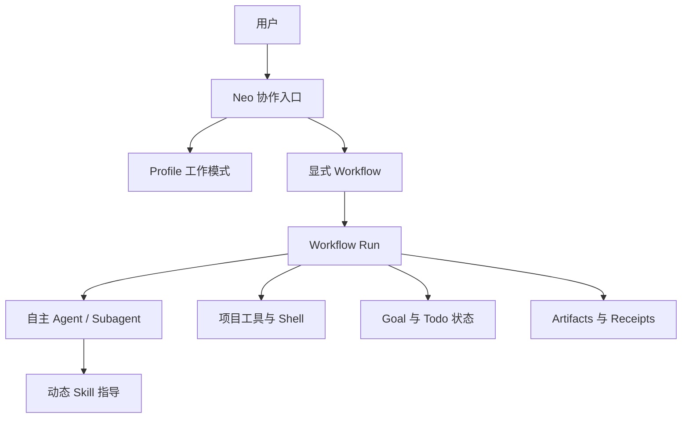

# Neo AI 协作编排工具

## Problem Frame

用户在不同场景下承担后端开发、问题排查、生产运维、全栈交付、小说创作和自媒体创作等完全不同的工作。把所有 Skill、Agent 和工作方法同时暴露给一个 Pi 会话，会造成上下文污染、领域规则混杂和工作流选择不稳定。

Neo 的目标不是建立一个严格的合规流程引擎，也不是替代 Agent 的判断能力，而是为 AI 开发协作提供可切换的领域工作模式、可复用的全局 Workflow、动态 Skill 发现、subagent 协作、Goal/Todo 追踪和高风险操作确认。

Neo 应该提供一条有方向的协作路线，同时允许 Agent 根据项目实际情况自主选择 Skill、调用 subagent、增加或跳过步骤，并记录计划与实际执行之间的差异。

---

## Actors

- A1. 个人开发者：在不同领域工作模式之间切换，显式启动 Workflow，提供决策并查看协作结果。
- A2. Neo 协作编排器：组织 Profile、Workflow、Goal、Todo、Agent、Skill 和运行记录。
- A3. Agent / Subagent：理解任务、选择参考 Skill、执行具体工作、调整协作路线并报告判断和不确定性。
- A4. Skill 库：提供领域知识、工作方法、项目规范和辅助资料；Skill 是指导材料，不是硬性前置条件。
- A5. 项目工具与外部系统：代码仓库、Shell 命令、构建系统、测试系统、部署平台和健康检查服务。

---

## Key Flows

- F1. **切换 Profile 后进行普通协作**
  - **Trigger:** 用户执行 `/neo profile use fullstack`。
  - **Actors:** A1, A2, A3, A4。
  - **Steps:** Neo 激活 Profile；普通用户消息继承该领域上下文；Agent 按需搜索 Skill 或调用 subagent；没有匹配 Skill 时使用已有知识继续。
  - **Outcome:** 用户获得领域相关协作，但普通对话不会自动启动长 Workflow。
  - **Covered by:** R1, R5, R6, R7。

- F2. **显式启动全局 Workflow**
  - **Trigger:** 用户执行 `/neo workflow run <workflow>`。
  - **Actors:** A1, A2, A3, A4, A5。
  - **Steps:** Neo 校验输入并展示初始路线；创建或关联 Goal；运行 Agent、Skill 和 Shell 节点；根据实际情况动态调整路线；在高风险外部操作前请求确认；记录结果和证据。
  - **Outcome:** 用户得到一个可恢复、可追踪、允许偏离初始计划的 Workflow Run。
  - **Covered by:** R2, R3, R8, R9, R10, R11, R12, R13。

- F3. **不切换 Profile 直接运行 Workflow**
  - **Trigger:** 用户在当前 Profile 下执行与当前领域不同的 Workflow。
  - **Actors:** A1, A2, A3, A4。
  - **Steps:** Neo 保留当前 Profile；为本次 Workflow 创建临时执行上下文；只提供 Workflow 和项目相关的领域线索；Workflow 完成后销毁临时上下文。
  - **Outcome:** 用户可以直接执行目标 Workflow，当前 Profile 不被永久改变，无关领域 Skill 不会自动污染本次任务。
  - **Covered by:** R4, R6。

- F4. **Agent 根据项目情况调整路线**
  - **Trigger:** Agent 在执行节点时发现原路线不适用、需要额外检查或需要新的 subagent。
  - **Actors:** A2, A3, A4, A5。
  - **Steps:** Agent 增加、跳过、拆分、合并或重排步骤；Neo 更新 Todo 和运行图；记录变更原因；继续执行；最终报告计划与实际路线的差异。
  - **Outcome:** Workflow 保持方向性但不僵化，用户能够理解 Agent 为什么改变路线。
  - **Covered by:** R10, R11, R12, R13。

---

## Requirements

**统一交互入口**

- R1. Neo 的用户命令统一使用 `/neo` 前缀，Profile、Workflow、Goal、Todo、Agent 和状态管理都作为子命令，不新增多个分散的顶层命令。
- R2. `/neo` 不带参数时应提供协作总览，至少显示当前 Profile、活动 Goal、运行中的 Workflow、Todo 进度、阻塞点和最近 Agent。
- R3. 高风险 Workflow 必须由用户明确指定 Workflow 名称后才能启动；AI 可以推荐 Workflow，但不能静默启动、替换或降级为另一套高风险流程。

**Profile 与上下文**

- R4. 用户可以通过 `/neo profile use <name>` 设置默认 Profile，也可以在执行单个 Workflow 时旁路当前 Profile，使用临时执行上下文。
- R5. Profile 表达领域关注点、推荐 Skill、可发现 Skill 范围、推荐 Agent、默认沟通风格、记忆范围和推荐 Workflow；这些内容主要是软指导，不要求 Agent 固定采用。
- R6. 直接运行 Workflow 不得强制用户先切换 Profile；当前 Profile 不兼容时，Neo 应优先创建临时上下文，而不是把当前 Profile 的无关领域知识带入任务。

**动态 Skill 与 Agent 协作**

- R7. Agent 可以在运行时搜索和加载当前上下文可发现范围内的 Skill；找不到匹配 Skill 时，必须允许 Agent 使用已有知识、项目内容和通用能力继续工作，不得仅因缺少 Skill 而阻断普通任务。
- R8. Agent 可以根据任务和项目实际情况选择是否调用推荐 subagent，也可以使用通用 Agent 或自己完成简单任务；Skill 和 subagent 都是协作建议，不是不可绕过的硬性依赖。
- R9. Neo 应记录本次运行实际使用的 Skill、subagent、主要选择和不确定性，使用户能够区分哪些结论来自加载的 Skill、项目证据或 Agent 已有知识。
- R10. Skill 不能自动提升 Agent 的工具权限；实际 Shell、文件、网络和外部系统能力仍由运行上下文和工具配置决定。

**声明式、可调整的 Workflow**

- R11. 全局 Workflow 应以声明式流程图表达初始协作路线、输入、建议节点、候选 Agent、建议 Skill、Shell 操作、确认点、输出和成功判断。
- R12. Workflow 至少应支持 Agent 节点、Shell 节点、人工确认节点、条件或分支、并行协作、Artifact 记录和外部 Receipt 记录。
- R13. Workflow 运行过程中，Agent 可以自由增加、跳过、拆分、合并和重排步骤，也可以根据发现选择不同的 Skill 或 subagent；Neo 必须记录每次调整及其原因。
- R14. Shell 节点允许执行任意项目命令；命令、工作目录、输入、环境变量、超时、输出、退出码和风险等级必须成为本次运行可见的信息。
- R15. 生产部署、数据库写入、资源删除、权限修改和其他高风险外部影响必须经过人工确认；分析、测试、构建和只读检查可以由 Agent 自主推进。
- R16. Workflow Run 必须支持暂停、恢复、停止和从失败或阻塞节点继续；已完成节点不应因为恢复而无理由重复执行。

**Goal、Todo 与证据**

- R17. Goal 表达用户想达成的最终结果，可以关联多个 Workflow Run；Workflow 可以改变达成 Goal 的路线，但不能静默改变 Goal 的含义。
- R18. Todo 应主要作为 Workflow Run 的动态状态投影，能反映新增、跳过、进行中、完成、失败和阻塞的节点；用户可以添加独立的手工 Todo。
- R19. 关键完成状态必须尽可能关联可验证证据，例如测试结果、Shell 退出码、健康检查、构建产物、部署地址、CI 链接或回滚信息；手工标记 Todo 完成不能伪造关键 Workflow 节点的完成。
- R20. Neo 应提供 Goal、Todo、Workflow Run、动态变更、用户确认、Artifacts 和 Receipts 的历史查询，使用户能够理解计划、实际执行路线和最终偏差。

**直接 Agent 协作**

- R21. 用户可以使用已有的 `@agent` 或底层 Agent 工具直接咨询或执行某个 subagent，不必创建完整 Workflow；Neo 可以提供对应的 `/neo agent` 管理入口，但不应破坏底层 subagent 插件的原生能力。
- R22. 普通自然语言可以用于补充上下文、指导当前 Agent、增加 Todo 和调整正在运行的 Workflow，但不能绕过高风险 Workflow 的显式启动和人工确认规则。

---

## Acceptance Examples

- AE1. **Covers R1, R2, R3.** 用户执行 `/neo workflow run release-to-production` 后，Neo 展示 Workflow 版本、项目输入、初始路线、风险和确认点；用户只说“把项目发布到生产”时，Neo 只推荐可用 Workflow，不直接启动。
- AE2. **Covers R4, R6.** 当前 Profile 是 `novel` 时，用户执行 `/neo workflow run release-to-production --project shop-api`；Neo 使用临时部署上下文，完成后当前 Profile 仍是 `novel`，小说相关 Skill 未被带入部署运行。
- AE3. **Covers R7, R8, R9.** Agent 搜索不到 Kubernetes 发布 Skill 时，仍根据项目配置、仓库脚本和已有知识生成方案，并在结果中说明没有加载专用 Skill，而不是返回失败。
- AE4. **Covers R13, R18, R20.** Agent 发现项目没有前端，跳过前端构建；发现有数据库迁移，新增数据库审查节点；Neo 更新 Todo，并在历史记录中显示新增和跳过的原因。
- AE5. **Covers R14, R15.** Agent 可以自主执行测试 Shell 节点；执行生产部署 Shell 节点前，Neo 展示实际命令、目录、环境、影响和回滚方式，并等待用户确认。
- AE6. **Covers R16, R17, R19.** 部署节点失败后，Workflow Run 进入失败状态；用户恢复运行时从失败节点继续；最终只有真实部署和健康检查证据存在时，Goal 才能被标记为完成。
- AE7. **Covers R21, R22.** 用户通过 `@database-reviewer` 直接咨询迁移风险，得到一次性专家结果，不必创建 Goal 或 Workflow；用户随后可以用自然语言把该结果作为当前 Workflow 的新增上下文。

---

## Success Criteria

- 用户能够用一个 `/neo` 命令空间找到和控制 Profile、Workflow、Goal、Todo 和运行状态。
- 用户能区分普通对话、直接 Agent 咨询和可追踪 Workflow 三种协作模式。
- 用户不需要为了执行一个临时 Workflow 永久切换 Profile，也不会把无关领域 Skill 自动带入任务。
- Agent 在没有匹配 Skill 或 subagent 时仍能继续工作，并能透明说明假设和不确定性。
- Workflow 能提供方向但不压制 Agent 的自主判断；动态增加、跳过和重排步骤都有记录。
- 生产部署等高风险 Shell 操作不会被普通自然语言或 Agent 的隐式判断绕过人工确认。
- Workflow Run 在暂停、失败、上下文压缩或 Pi 重启后仍能恢复，并保留计划、实际路线、Todo 和证据。
- 后续实现者可以基于本文档设计技术方案，而不需要重新发明产品行为和范围边界。

---

## Scope Boundaries

### Deferred for later

- 自动从自然语言静默选择并启动 Workflow。
- Workflow 市场、远程 Skill 同步和跨机器 Profile 同步。
- 多种 subagent runtime 同时运行并自动负载均衡。
- Cron、长期后台 Mission、跨项目调度和团队协作通知。
- 复杂的语义 Skill 推荐、向量检索和自动 Skill 生成。
- 多用户权限、组织级审批、合规策略和审计平台。
- 自动发布、自动合并和完全无人值守的生产运维。

### Outside this product's identity

- Neo 不定位为严格合规或安全沙箱；用户加载的 Extension、Skill、Workflow 和 Shell 本身必须可信。
- Neo 不替代 CI/CD 平台、云平台控制台、项目管理系统或团队工单系统。
- Neo 不试图消除 Agent 的主观判断，也不把所有开发协作强制转换成固定状态机。
- Neo 不承诺仅通过 Skill 内容阻止恶意或危险操作；工具权限、人工确认和用户信任边界仍然重要。

---

## Key Decisions

- **统一使用 `/neo` 前缀：** 避免占用多个 Pi 顶层命令，并为后续协作能力保留一致的命名空间。
- **Profile 是软性的领域协作模式：** 它提供默认背景、推荐 Skill、Agent、Workflow 和记忆，不要求固定执行路径。
- **Workflow 必须显式启动，但运行中可自由调整：** 高风险流程的入口可控，执行过程保留 Agent 的主观能动性。
- **Workflow 使用全局声明式流程图：** 便于跨项目复用；项目负责提供命令、环境和部署事实。
- **允许任意 Shell：** 满足开发和运维场景的实际需要；Shell 的风险、确认、日志和恢复行为由 Neo 记录和控制。
- **Skill 是指导材料而非硬依赖：** 找不到 Skill 时 Agent 使用已有知识继续，不把普通 Skill 缺失变成流程失败。
- **Goal 稳定、Workflow 和 Todo 可变：** Agent 可以改变达成目标的路线，但不能静默改变用户真正想要的结果。
- **保留原生 subagent 入口：** Neo 在其上增加协作管理能力，不替换底层 Agent、结果获取、恢复和 steer 能力。

---

## Dependencies / Assumptions

- Pi 当前版本支持 Extension、Command、Tool、持久化 Session 和自定义 UI 能力。
- Pi SDK 提供 `createAgentSession`、`AgentSession`、`SessionManager`、`ModelRuntime`、`ResourceLoader` 和事件流等 Native Runtime 所需的公开能力。
- `example/pi-subagents`、`example/tintinweb-pi-subagents` 和 `example/pi-tasks` 作为设计和失败模式参考；Neo MVP 不要求它们作为子会话执行依赖。
- 用户运行的 Workflow、Skill、Extension、Agent 定义和 Shell 命令位于可信环境中。
- 项目可以提供必要的工作目录、构建命令、测试命令、部署命令、健康检查和回滚信息。
- 高风险确认默认由当前用户完成；MVP 不解决组织级审批和多用户权限。
- Agent 输出可能不完整、错误或被项目内容影响；Neo 记录证据和不确定性，但不把模型判断自动视为事实。

---

## Outstanding Questions

### Resolve Before Planning

- 无。当前产品行为和 MVP 范围已经足够进入技术规划。

### Deferred to Planning

- [Affects R11, R13, R16] [Technical] Native Runtime 基于 Pi SDK 的 child session 创建、资源隔离、动态 Skill 注入、恢复和并发策略。
- [Affects R11, R13, R16] [Technical] 声明式 Workflow 的具体文件格式、节点表达、动态变更记录和恢复方式。
- [Affects R7, R9] [Technical] 动态 Skill 搜索和加载如何与 Pi 当前的 Skill discovery 及子会话上下文结合。
- [Affects R14, R15] [Technical] 任意 Shell 的进程管理、输出截断、秘密脱敏、超时、取消和退出码处理。
- [Affects R17-R20] [Technical] Goal、Todo、Workflow Run、Artifact 和 Receipt 的持久化边界及清理策略。
- [Affects R1, R2] [Technical] `/neo` 面板、状态栏、确认界面和底层 Agent Fleet/child-session UI 如何协同展示。
- [Affects R21] [Needs research] 两套 subagent 插件同时存在时的工具名、事件和生命周期冲突处理。

---

## Next Steps

-> `/ce-plan`：基于本需求文档进行技术规划，先完成 Native Runtime、Workflow DSL、运行状态和 `/neo` 交互的实现设计。
